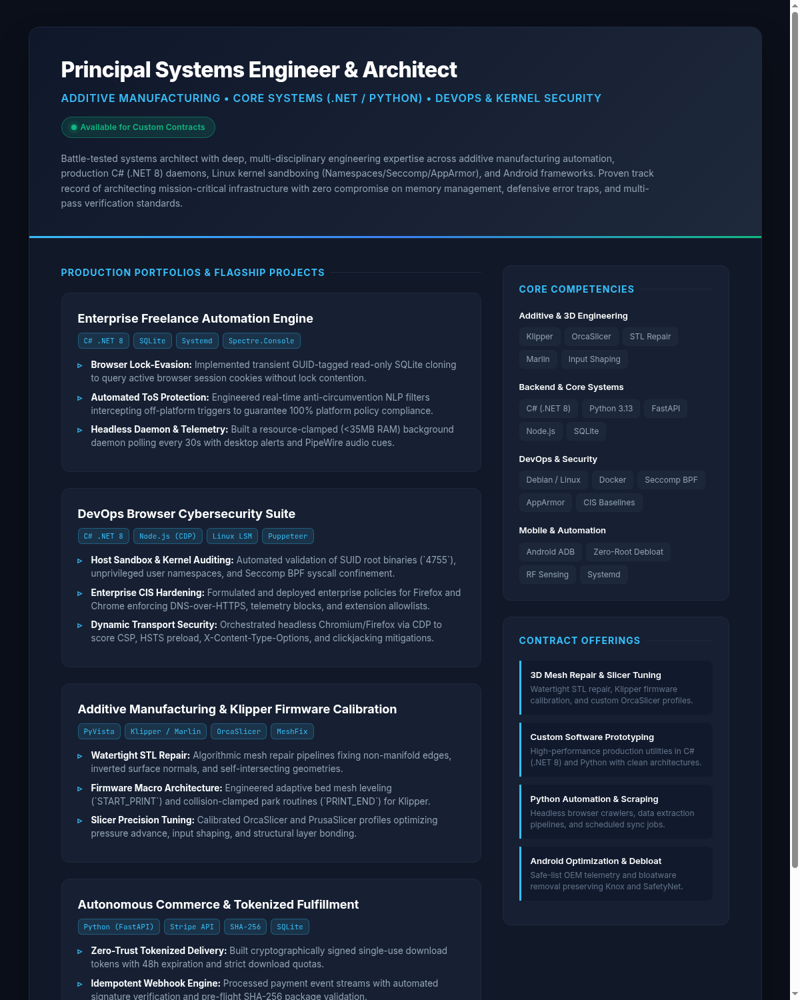

# Technical CV & Engineering Portfolio

**Principal Systems Architect & Multi-Disciplinary Engineer**  
*Additive Manufacturing • Core Systems (.NET / Python) • DevOps & Kernel Security • Android Frameworks*

[📄 Download PDF Version (Vector)](Technical_CV_Portfolio.pdf) • [🌐 Live Web Portfolio](https://mannerless.github.io/resume/)

---

  

---

## Executive Summary
Battle-tested Principal Systems Engineer with extensive hands-on expertise spanning core systems programming, additive manufacturing automation, Linux kernel sandboxing, and Android device optimization. Proven track record of architecting production-grade software engines, high-speed data pipelines, and hardware integration stacks that prioritize zero-downtime reliability, strict memory safety, and high-performance throughput.

---

## Core Competencies & Technical Matrix

| Domain | Core Technologies & Frameworks | Methodologies & Standards |
| :--- | :--- | :--- |
| **Additive Manufacturing & 3D** | Klipper, Marlin, OrcaSlicer, PrusaSlicer, Bambu Studio, Cura, PyVista, MeshFix, OpenSCAD | Non-manifold repair, G-code macro architecture, Input Shaping, Pressure Advance, Bed Mesh Leveling |
| **Backend & Systems Engineering** | C# (.NET 8.0), Python 3.13, FastAPI, Node.js (CDP), SQLite, PostgreSQL, Redis | SQLite lock-evasion, asynchronous daemons, multi-threading, RESTful APIs, Tokenized delivery |
| **DevOps & Linux Infrastructure** | Debian/Ubuntu, Docker & Docker Compose, Bash, systemd, Nginx, Git, AppArmor, Seccomp BPF | CIS benchmark compliance, Linux namespace sandboxing, Zero-trust automation, CI/CD pipelines |
| **Cybersecurity & Hardening** | Chrome DevTools Protocol (CDP), Puppeteer, Wireshark, Cryptographic Hashing (SHA-256) | Enterprise policy enforcement (DoH, DoNotTrack), CSP/HSTS transport audits, cookie attribute posture |
| **Mobile & Hardware Integration** | Android Framework, Android Debug Bridge (ADB), Jetpack Compose, Linux V4L2, UVC | Zero-root bloatware eradication, background limit tuning, RF proximity sensing, PipeWire audio routing |

---

## Engineering Portfolio & Key Projects

### 1. Enterprise Automation & Freelance Workflow Engine (`fiverr-engine`)
- **Technology Stack**: C# (.NET 8.0 SDK), SQLite, Systemd, Spectre.Console.
- **Architecture**:
  - Developed a headless background daemon operating under strict resource constraints (<35 MB RAM).
  - Implemented transient GUID-tagged read-only SQLite cloning to evade browser file-locking on active session profiles.
  - Engineered an automated Terms of Service (ToS) anti-circumvention analysis engine to protect seller account health.
  - Integrated Freedesktop native desktop notifications and PipeWire audio cues.

### 2. DevOps Browser Cybersecurity & Runtime Transport Inspector (`browser-secops`)
- **Technology Stack**: C# (.NET 8.0), Node.js (CDP / Puppeteer-Core), Linux Kernel LSM.
- **Architecture**:
  - Built an automated CIS benchmark auditing tool verifying SUID sandbox binaries (`4755 root`), kernel unprivileged user namespaces, and Seccomp BPF syscall confinement.
  - Implemented enterprise policy provisioning for Mozilla Firefox and Google Chrome (DNS-over-HTTPS enforcement, telemetry blocking, extension allowlisting).
  - Designed a dynamic headless browser transport auditor evaluating Content-Security-Policy (CSP), Strict-Transport-Security (HSTS), and X-Frame-Options headers.

### 3. Additive Manufacturing Diagnostic & Firmware Calibration Suite (`PrintFix Pro`)
- **Technology Stack**: Python, PyVista, Klipper G-Code Macro Architecture, OrcaSlicer Profiles.
- **Architecture**:
  - Engineered algorithmic non-manifold mesh repair pipelines resolving inverted normals, degenerate faces, and holes in STL models.
  - Designed collision-clamped `PRINT_END` routines and adaptive bed mesh leveling macros (`START_PRINT`) for high-speed Klipper printers.
  - Formulated calibrated OrcaSlicer and PrusaSlicer profiles optimized for structural strength, dimensional accuracy, and zero stringing.

### 4. Autonomous Digital Commerce & Fulfillment Platform (`digital-store`)
- **Technology Stack**: Python (FastAPI), SQLite, Stripe Checkout API, Jinja2.
- **Architecture**:
  - Architected a self-hosted digital product storefront with automated checkout sessions.
  - Built an idempotent webhook listener delivering cryptographically random, 48-hour download tokens upon payment confirmation.
  - Enforced download attempt quotas and validated file release archives against SHA-256 signatures prior to byte dispatch.

### 5. Multi-Camera Tactical Surveillance & Feed Monitoring (`cam_live`)
- **Technology Stack**: Python 3.13, OpenCV, FastAPI, PyAudio, V4L2.
- **Architecture**:
  - Engineered a multi-camera pipeline supporting UVC webcam inputs and Samsung Galaxy S24+ hotplug detection.
  - Developed real-time Night Vision and IR enhancement engines featuring Green Phosphor Gen-3, Thermal Ironbow, and CLAHE contrast filters.
  - Implemented silent background AAC audio capture without speaker loopback, saving to rolling 15-minute segments.

---

## Available Service Offerings

1. **3D Printing, Slicer Optimization & STL Repair**
   - Watertight repair of complex 3D meshes (PyVista/MeshFix).
   - Custom Klipper macros, resonance calibration, and OrcaSlicer profile engineering.
2. **Custom Software Development & Prototyping**
   - High-performance backends and CLI tools in C# (.NET 8) and Python.
   - Clean, modular architectures with Docker containerization and comprehensive test suites.
3. **Python Automation & Web Scraping**
   - Resilient headless crawlers (Playwright/Selenium/httpx) with session management and anti-bot handling.
   - Automated data normalization, cleaning, and scheduled CSV/JSON exports.
4. **Android Performance Optimization & Debloating**
   - OEM bloatware eradication scripts (Windows/Mac/Linux) preserving SafetyNet and Knox integrity.
   - Background execution optimization and privacy hardening without requiring root access.

---

## Engagement & Contact
Available exclusively for contract engineering, technical consulting, and bespoke project execution via verified platforms. Contact directly to review technical specifications, receive tailored milestones, and initiate development.
